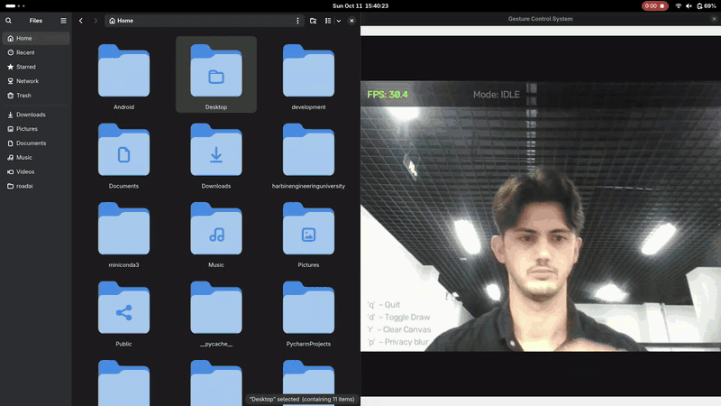

# Gesture Control System

[](https://github.com/diyor-ai/gesture-control-system/actions/workflows/ci.yml)

<p align="center">
  
</p>
<p align="center"><em>Real run on Fedora 44 / GNOME 50 Wayland, CPU only, ~30 FPS: double click to open folders, scroll down and up, volume, screenshot.</em></p>

Control your computer with hand gestures: a webcam goes in, mouse, scroll, volume and media control come out. Python, MediaPipe, OpenCV.

## Highlights

- **Edge-triggered clicks.** A pinch fires one click when it starts and must be released before the next. A double click is two separate pinches within 0.85 s, sent to the OS as two clicks 50 ms apart at a locked cursor position.
- **Per-hand stability layer.** A pose must be seen on 3 consecutive frames (about 100 ms at 30 FPS) before it activates, so detector flicker cannot fire or re-arm gestures. Each hand keeps its own state, and a 5-frame grace period rides out tracking dropouts.
- **Distances in palm lengths.** Pinch, volume, brightness, zoom, scroll and swipe thresholds are divided by the wrist-to-middle-finger-base length, so they behave the same near and far from the camera.
- **Privacy mode for demos.** Press `p` to blur the camera image beyond recognition; the hand skeleton and HUD stay sharp on top.
- **Works on Wayland.** Input is injected through a virtual absolute pointer (`uinput` via python-evdev) with the position mapped to the detected screen size. PyAutoGUI is used on X11, Windows and macOS.
- **Slow OS calls never block the camera loop.** Volume and brightness changes pass a 3 % step filter, then run on a background worker that keeps only the newest value.
- **228 pytest tests, no camera needed.** They run in about 1.6 s against synthetic hand landmarks, a fake clock and a fake uinput device.
- **Measured performance.** Camera plus tracking runs at 29.9 FPS with a hand in view (camera limit 30.1), up from 16.5–21.6 FPS with the first settings.

## Quick start

```bash
conda create -n gesture311 python=3.11 -y && conda activate gesture311
pip install -r requirements.txt
python main.py            # q quit · d toggle drawing · r clear canvas · p privacy blur · f fullscreen
python main.py --debug    # finger states, raw/stable pose, pinch ratios, FPS
```

Python 3.11 is what I develop on; MediaPipe 0.10.14 supports 3.9–3.12. On Linux/Wayland, do the one-time [Wayland setup](#wayland-setup-linux) first.

## Gestures

`T I M R P` = thumb, index, middle, ring, pinky. The **primary hand** (`PRIMARY_HAND`, default Right) drives the cursor; the other hand gets zoom.

| Gesture | Hand | Pose | Behaviour |
|---------|------|------|-----------|
| Move cursor | primary | Index up, M R P down, thumb free | Fingertip mapped to the screen, smoothed |
| Click | primary | Same pose, thumb tip pinched onto index tip | One click per pinch |
| Double click | primary | Two pinches within 0.85 s | Second pinch sends a fast click pair at the locked position |
| Right click | primary | Only middle up, thumb pinched onto middle tip | One click per pinch |
| Draw | primary | Index pose while the canvas is on (`d`) | Draws on the camera overlay |
| Zoom | other | Thumb + index up, M R P down (L shape) | Thumb–index spread sends Ctrl + scroll |
| Scroll | either | Index + middle up, R P down | Hold the hand above/below where the gesture started |
| Volume | either | Thumb + pinky up, I M R down | Thumb–pinky spread = 0–100 % |
| Brightness | either | Thumb + ring up, I M P down | Thumb–ring spread = min–max |
| Play / pause | either | Index + middle + ring up, pinky down | Hold 0.5 s, fires once |
| Next / previous track | either | Index + pinky up, M R down, swipe right / left | One event per swipe, 1 s cooldown |
| Screenshot | either | All five fingers up | Hold 1 s, fires once, 5 s cooldown. Saved to `screenshots/`; on GNOME/Wayland GNOME saves it to `~/Pictures/Screenshots` |

Fist drags the active window on Windows and macOS only; it is disabled on Linux (`WINDOW_DRAG_ENABLED`).

## Architecture

```
Camera ─► read_frame (bounded retries) ─► flip
            │
            ▼
      HandTracker (MediaPipe Hands, 21 landmarks per hand)
            │  landmarks + Left/Right label
            ▼
      GestureEngine ── per hand: finger states ─► raw pose ─► stability layer ─► gesture
            │                    (palm-length distances)     (N frames, grace period)
            ▼
      Dispatcher (main.py) ─► CursorController · ScrollController · ZoomController
            │                  MediaController · ScreenshotModule · DrawingCanvas
            │                  VolumeController / BrightnessController ─► background worker
            ▼
      input_backend ─► UInputBackend (Wayland, kernel uinput)
                    └► PyAutoGUIBackend (X11, Windows, macOS)
```

The engine is a classifier with state, not a stateless function: it keeps timers, pinch latches and swipe history per hand. `ui_overlay` draws the HUD and the `--debug` panel on the frame.

## Engineering notes

| Problem | Fix |
|---------|-----|
| Clicks fired on every frame while pinching (about 30/s) | Event gestures are edge-triggered; a held pose fires once |
| Play/pause was unreachable (the 5-finger screenshot rule shadowed it) | Every gesture has its own pose; play/pause is a 3-finger hold |
| Thumb + index triggered zoom when the user only wanted the cursor | Zoom moved to the other hand; the L shape is cursor/click on the primary hand |
| Thumb detection compared x coordinates and broke on the right hand | Compare tip and IP distance to the pinky base, which is handedness-independent |
| Both hands moved the same cursor and shared timers | Cursor gestures belong to one primary hand; engine state is per hand |
| `amixer`/`xrandr` subprocesses blocked the loop on every frame | Step filter plus a coalescing background worker with a 2 s timeout |
| Swipe direction was inverted (the frame is already mirrored) | Fixed and covered by a test |
| Drawing crashed because the camera ignored the 1280×720 request | The canvas is sized from the first real frame |
| Pointer injection silently did nothing on Wayland | Virtual absolute pointer through uinput |
| A double click would have sent three clicks | Second pinch sends a fast pair (50 ms apart) at a cursor locked for 0.85 s after each click |

## Performance

Measured with `tools/benchmark_fps.py` (real webcam and MediaPipe, no window, no input injection) on Fedora 44, CPU only, with a hand in view. The webcam delivers 640×480 at 30 FPS and ignores a 1280×720 request.

| Setting | Camera + tracking FPS |
|---------|-----------------------|
| 1280×720 requested, `MODEL_COMPLEXITY = 1` | 16.5 – 21.6 |
| 640×480, `MODEL_COMPLEXITY = 0` (current defaults) | 29.9 |
| Camera alone | 30.1 |

Runs vary by about ±3 FPS. The full application (window, HUD, input injection) has not been benchmarked.

## Testing

```bash
pip install -r requirements-dev.txt
pytest                      # 228 tests in 17 files, about 1.6 s, no camera or display
```

They cover every gesture pose on both hands, click edge-triggering, stability and hand-loss behaviour, hand-size invariance (0.4× to 1.6×), the uinput event stream, Linux backend fallbacks, camera retries, canvas sizing and the debug overlay. Manual checks: `tools/uinput_selftest.py` (moves the pointer after asking) and `tools/benchmark_fps.py`.

## Configuration

Everything is in `modules/config.py`. Distances are in palm lengths.

| Setting | Value | Meaning |
|---------|-------|---------|
| `PRIMARY_HAND` | `"Right"` | Hand for cursor, clicks, drawing |
| `STABILITY_FRAMES` | 3 | Frames a pose must persist to activate |
| `HAND_LOSS_GRACE_FRAMES` | 5 | Dropout frames tolerated before state resets |
| `CLICK_THRESHOLD` | 0.20 | Maximum thumb-to-fingertip distance for a pinch |
| `DOUBLE_CLICK_INTERVAL` | 0.85 s | Maximum time between two pinch starts |
| `CLICK_LOCK_TIME` | 0.85 s | Cursor frozen after a click so both pinches hit one pixel |
| `WINDOW_SCALE` | 1.5 | Initial window size = camera frame size × this (640×480 → 960×720); the image is letterboxed on a dark background |
| `PRIVACY_START` | `False` | Start with the camera image blurred (`p` toggles) |
| `SCROLL_DEADZONE` | 0.15 | Palm lengths around the start position where nothing scrolls |
| `SCROLL_FULL_SPEED_OFFSET` / `SCROLL_MAX_SPEED` | 0.8 palm / 15 notches/s | Offset at which scrolling reaches full speed, and that speed (offsets beyond are clamped) |
| `SCROLL_EXPONENT` | 1.5 | Curve between dead zone and full speed; higher = gentler near the dead zone |
| `SCROLL_ANCHOR_GRACE` | 0.6 s | The scroll start position survives pose dropouts this long |
| `SCROLL_NATURAL` | `False` | `False`: hand below the start = scroll down; `True`: inverted |
| `SCREENSHOT_HOLD_TIME` / `PLAY_PAUSE_HOLD_TIME` | 1.0 s / 0.5 s | Hold time before firing |
| `SCREENSHOT_COOLDOWN` | 5.0 s | Minimum time between screenshots |
| `SCREENSHOT_KEYS` | `("shift", "print")` | GNOME/Wayland: shortcut typed through uinput (`gsettings get org.gnome.shell.keybindings screenshot`) |
| `VOLUME_MIN_DIST` / `MAX_DIST` | 0.10 / 1.60 | Thumb–pinky spread mapped to 0–100 % |
| `BRIGHTNESS_MIN_DIST` / `MAX_DIST` | 0.10 / 1.30 | Thumb–ring spread mapped to min–max |
| `VOLUME_STEP` / `BRIGHTNESS_STEP` | 0.03 | Minimum change before the OS is touched |
| `SMOOTHING_FACTOR` / `CONTROL_ZONE_MARGIN` | 0.30 / 0.15 | Cursor smoothing, ignored frame border |
| `FRAME_WIDTH` × `FRAME_HEIGHT` | 640 × 480 | Requested camera size |
| `MODEL_COMPLEXITY` | 0 | MediaPipe landmark model (0 fast, 1 accurate) |
| `DETECTION_CONFIDENCE` / `TRACKING_CONFIDENCE` | 0.75 / 0.75 | MediaPipe thresholds |
| `INPUT_BACKEND` | `"auto"` | `auto`, `uinput` or `pyautogui` (or `$GESTURE_INPUT`) |

## Wayland setup (Linux)

PyAutoGUI cannot move the pointer on native Wayland (measured on Fedora 44 / GNOME 50). The app instead creates a virtual absolute pointer through `/dev/uinput`, which needs access to that device. **Do not add yourself to the `input` group**: it would let every program you run read your keyboard. A dedicated `uinput` group that only owns `/dev/uinput` is enough. Run once:

```bash
sudo groupadd --system uinput
sudo usermod -aG uinput "$USER"
sudo cp linux/99-gesture-uinput.rules /etc/udev/rules.d/
sudo cp linux/uinput.conf /etc/modules-load.d/gesture-uinput.conf
sudo udevadm control --reload-rules
sudo udevadm trigger --name-match=uinput
sudo modprobe uinput
sudo dnf install brightnessctl                     # brightness
```

`gnome-screenshot` or `grim` is only a fallback for non-GNOME desktops; on GNOME 50 screenshots go through the uinput shortcut.

Log out and back in, then check:

```bash
id -nG | tr ' ' '\n' | grep -x uinput     # prints "uinput"
python tools/uinput_selftest.py           # asks first, then draws a square with the pointer (no clicks)
```

Members of `uinput` can inject input events but cannot read them. To undo: `sudo gpasswd -d "$USER" uinput` and `sudo rm /etc/udev/rules.d/99-gesture-uinput.rules`. With `auto`, the app falls back to PyAutoGUI and prints a warning if `/dev/uinput` is not accessible. Volume uses `wpctl`, then `pactl`, then `amixer`; brightness uses `brightnessctl`, then `xrandr`. Override screen detection with `GESTURE_SCREEN=2560x1440`.

## Troubleshooting

- **Camera not found / "no frames" error:** the app gives up after 30 failed reads (about 3 s). Try another `CAMERA_INDEX`.
- **Pointer does not move on Wayland:** the start-up line should read `Input backend: uinput`. If it says `pyautogui`, redo the Wayland setup and log in again.
- **Screenshot on GNOME/Wayland:** `gnome-screenshot` is blocked there, so the uinput backend types the shortcut in `SCREENSHOT_KEYS`; the file is in `~/Pictures/Screenshots`. Elsewhere install `gnome-screenshot` (or `grim` on wlroots).
- **Brightness has no effect:** install `brightnessctl`; the `xrandr` fallback is unlikely to work on Wayland.
- **Cursor stops or clicks land on the wrong hand:** MediaPipe's Left/Right label can flip; check it with `--debug` or change `PRIMARY_HAND`.
- **Low FPS:** run `python tools/benchmark_fps.py` to separate camera and tracking cost.

## Limitations

- Tested only on Fedora 44 / GNOME 50 Wayland. The Windows (pycaw, win32) and macOS (AppleScript) code paths exist but have never been run.
- Cursor, clicks, screenshot, swipe and canvas toggle were verified by hand on real hardware (Fedora 44 / GNOME 50).
- No accuracy measurement yet; the engine is rule-based and thresholds were tuned by hand.
- Joystick scrolling, the click lock, fast double click and privacy blur are covered by tests but not yet verified by hand on hardware.
- Window drag is not available on Linux.
- The full application loop has not been benchmarked, and the gesture-to-pointer path on real hardware is verified only after the uinput setup above.
- One webcam, one user; Left/Right labels come from MediaPipe and can occasionally flip.

## Roadmap

- Trained ML gesture classifier with an accuracy benchmark against the rule-based engine
- Presentation mode (slide control)
- Browser demo

Started as a course project at Harbin Engineering University, May 2026.
